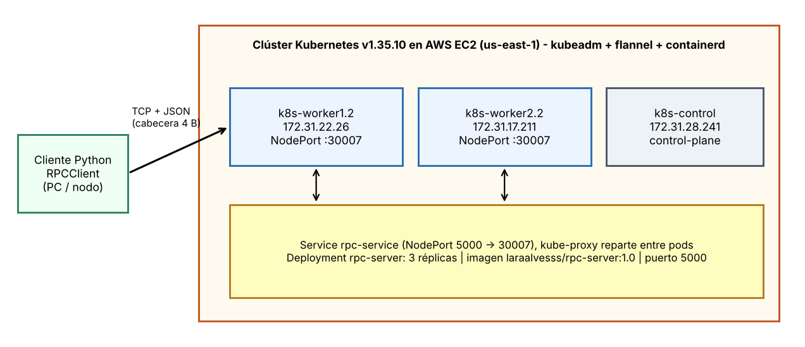
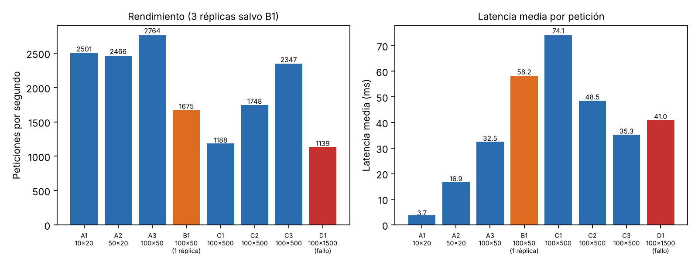

# Sistema RPC desplegado en Kubernetes sobre AWS EC2

Memoria de la Práctica 2 de Sistemas Distribuidos: diseño, configuración, prueba de carga y resultados. 

**Asignatura:** Programación de Sistemas Distribuidos – Práctica 2 (U-tad) · **Autor/a:** Lara Alves · **Fecha de las pruebas:** 20–23 de noviembre de 2026

## 1. Objetivo

Se construye un sistema de **llamadas a procedimientos remotos (RPC)** en Python, se empaqueta en una imagen Docker y se despliega en un **clúster Kubernetes de tres nodos sobre instancias EC2**. Se comprueba que el servicio es accesible desde fuera del clúster, que las peticiones se reparten entre réplicas y que el sistema escala y tolera la caída de un pod, midiéndolo con una prueba de carga.



## 2. Diseño

**Protocolo.** Transporte TCP; mensajes JSON codificados en UTF-8 con una cabecera de 4 bytes (entero sin signo, orden de red) que indica la longitud. La lectura exacta de `n` bytes evita los problemas de fragmentación de TCP. Una petición es `{"function": "sumar", "args": [4, 7]}` y la respuesta `{"status": "ok", "result": 11}` o `{"status": "error", "error": CÓDIGO, "message": ...}`.

**Servidor.** Un *dispatcher* (`RPCServer`) con registro explícito de procedimientos (`sumar`, `multiplicar`, `potencia`, `tarea_lenta`, `dividir`, `factorial`, `es_primo`, `invertir_cadena`). Valida la petición, comprueba los argumentos contra la firma de la función y devuelve errores tipificados: `INVALID_REQUEST`, `PROCEDURE_NOT_FOUND`, `INVALID_ARGUMENTS`, `EXECUTION_ERROR`. Escucha en `0.0.0.0:5000` y atiende cada conexión en un hilo propio (los logs del pod muestran `Thread-N (handle_client)`), por lo que admite clientes concurrentes.

**Cliente.** `RPCClient(host, puerto, timeout=5).call("función", *args)` abre una conexión por llamada, aplica *timeout* y convierte los errores remotos en la excepción `RPCError`. Esta decisión (una conexión por llamada) es simple y robusta, pero condiciona el rendimiento medido en la sección 4.

**Cómo probarlo en local**

```bash
docker build -t rpc-server .
docker run -p 5000:5000 rpc-server
python -c "from client.rpc_client import RPCClient; print(RPCClient('127.0.0.1', 5000).call('sumar', 4, 7))"   # 11
```

En Kubernetes: `kubectl apply -f k8s/` y llamar a `IP_de_un_nodo:30007`. La memoria completa paso a paso está en [docs/DOCUMENTACION_COMPLETA.md](docs/DOCUMENTACION_COMPLETA.md).

## 3. Configuración

**Infraestructura (AWS, us-east-1).** Tres instancias EC2 con Ubuntu 26.04.1 LTS (kernel 7.0.0-1018-aws, cgroup v2): `k8s-control` (172.31.28.241), `k8s-worker1.2` (172.31.22.26) y `k8s-worker2.2` (172.31.17.211). Disco de 27 GB (15 % usado). Los scripts `kub_install.sh` y `kub_reset.sh` automatizan la instalación del plano de control; los workers se preparan con `ip_forward=1`, módulos de red de *bridge* y `containerd` activo, y se unen con `kubeadm join`.

**Clúster.** Kubernetes v1.35.10 con `containerd 2.2.2` y red de pods **flannel** (pods en 10.244.x.x). Los tres nodos aparecen en estado *Ready* y todos los pods del sistema en *Running*.


**Imagen.** `python:3.12-slim`, `WORKDIR /app`, copia de `common/` y `server/`, `EXPOSE 5000`, `PYTHONUNBUFFERED=1` y `CMD ["python","-m","server.server"]`. Se construyó como `laraalvesss/rpc-server:1.0` (43 MB de contenido), se probó en local con `docker run -p 5000:5000` y se publicó en Docker Hub (repositorio público).

**Kubernetes.** `Deployment rpc-server` con **3 réplicas** (etiqueta `app=rpc-server`, 2 en worker2 y 1 en worker1 en el primer reparto) y `Service rpc-service` de tipo **NodePort** (5000 → 30007). El servicio se alcanza en `IP_de_cualquier_nodo:30007`; en el grupo de seguridad hay que abrir el puerto 30007/TCP. Los manifiestos están en `k8s/`.


**Verificación funcional.** `sumar(4, 7)` devuelve 11 desde ambos workers por NodePort y desde un PC Windows externo contra la IP pública `IP_PÚBLICA_EC2:30007` . Diez llamadas consecutivas aparecen repartidas en los logs de distintos pods: el Service balancea la carga.

## 4. Prueba de carga

**Método.** El script `carga.py HOST PUERTO HILOS PETICIONES_POR_HILO` lanza varios hilos que llaman a `sumar(4, 7)` contra `172.31.22.26:30007` y calcula peticiones correctas y erróneas, tiempo total, peticiones por segundo y latencia media y máxima. Se ejecutó desde el nodo `k8s-control`, con tamaños crecientes:

| Escenario | Réplicas | Hilos × pet./hilo | Total |
|---|---|---|---|
| A1–A3: carga progresiva | 3 | 10×20, 50×20, 100×50 | 200 – 5 000 |
| B1: referencia sin escalar | 1 | 100×50 | 5 000 |
| C1–C3: carga sostenida | 3 | 100×500 (×3 repeticiones) | 50 000 |
| D1: **fallo de un pod en plena carga** | 3 | 100×1500 | 150 000 |



En D1 se borró un pod (`kubectl delete pod`) mientras la prueba estaba en marcha; Kubernetes creó un pod de sustitución.

## 5. Resultados

| Esc. | Réplicas | Total | Correctas | Errores | Tiempo (s) | Pet./s | Lat. media (ms) | Lat. máx (s) |
|---|---|---|---|---|---|---|---|---|
| A1 | 3 | 200 | 200 | 0 | 0,08 | 2 501,0 | 3,7 | 0,0091 |
| A2 | 3 | 1 000 | 1 000 | 0 | 0,41 | 2 465,9 | 16,9 | 0,0451 |
| A3 | 3 | 5 000 | 5 000 | 0 | 1,81 | 2 763,9 | 32,5 | 0,0976 |
| B1 | 1 | 5 000 | 5 000 | 0 | 2,98 | 1 675,2 | 58,2 | 0,0783 |
| C1 | 3 | 50 000 | 50 000 | 0 | 42,09 | 1 188,0 | 74,1 | 4,1353 |
| C2 | 3 | 50 000 | 50 000 | 0 | 28,61 | 1 747,5 | 48,5 | 2,1786 |
| C3 | 3 | 50 000 | 50 000 | 0 | 21,30 | 2 347,4 | 35,3 | 3,0954 |
| D1 | 3 | 150 000 | 149 727 | **273** | 131,71 | 1 138,9 | 41,0 | 5,0045 |


**Análisis.**

- **Escalado horizontal.** Con la misma carga (100 hilos × 50), pasar de 1 a 3 réplicas sube el caudal de 1 675 a 2 764 peticiones/s (**+65 %**) y baja la latencia media de 58,2 a 32,5 ms (**−44 %**). La mejora no es 3× porque el generador de carga y el clúster comparten recursos (ver limitaciones).
- **Reparto de carga.** El recuento de peticiones por pod tras la prueba A3 es muy homogéneo (2 000, 2 014 y 1 955 en los pods visibles), lo que confirma el balanceo del Service.
- **Fiabilidad.** Hasta 50 000 peticiones sostenidas no hubo ningún error: 0 de 50 000 en tres ejecuciones.
- **Variabilidad.** Las tres repeticiones de 100×500 dan entre 1 188 y 2 347 peticiones/s: hay un efecto de calentamiento y de ruido de la máquina virtual, así que conviene comparar escenarios con varias repeticiones y no con una sola.
- **Tolerancia a fallos.** En D1 se perdieron **273 de 150 000 peticiones (0,18 %)**, y el máximo de latencia (5,0045 s) coincide con el *timeout* de 5 s del cliente. La explicación más probable es que las conexiones dirigidas al pod eliminado, antes de que dejara de recibir tráfico del Service, agotaron el tiempo (hipótesis: no se midió a nivel de *endpoints*). El servicio no se interrumpió y Kubernetes restauró las 3 réplicas por sí solo; sin reintentos en el cliente, esas llamadas se pierden.

## 6. Conclusiones y limitaciones

El sistema cumple los objetivos: el RPC funciona desde fuera del clúster, escala con el número de réplicas, balancea la carga y se recupera de la caída de un pod con una pérdida inferior al 0,2 %.

**Limitaciones.** (1) El generador de carga corre en un nodo del propio clúster y compite por CPU con los pods. (2) Cada llamada abre una conexión TCP nueva, lo que penaliza el rendimiento. (3) Los resultados provienen de una sola sesión y con variabilidad notable entre repeticiones. (4) El `Deployment` no declara *requests/limits* ni `readinessProbe`, por lo que la retirada de un pod del Service no es ordenada.

**Mejoras posibles.** Reintentos con *back-off* en el cliente; sondas `readinessProbe` y un `preStop` con `terminationGracePeriodSeconds` para retirar pods del Service antes de pararlos; conexiones persistentes; generador de carga externo al clúster; y un `HorizontalPodAutoscaler`.

